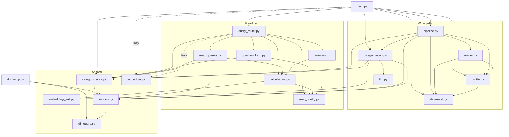
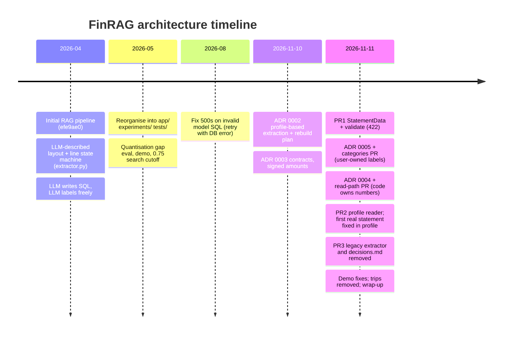

# FinRAG system overview and architecture

Status: written 2026-11-11, at the project's wrap-up (598 unit and 60 integration tests). Verified against the code on `main` at `2fdd28a`. Where this guide and the code disagree, the code wins.

This is the entry point to the guide. It explains what FinRAG is, the few rules that shape every module, how the pieces fit together, and how the design got here. Each later document goes deeper on one area; see the [reading guide](#11-reading-guide) at the end.

---

## 1. What the app does, and for whom

FinRAG is a personal finance assistant for one person, running on one laptop.

- **In:** PDF credit card statements (today: Wells Fargo credit card only, ADR 0002 Decision 1).
- **Stored:** every transaction, signed, in Postgres, with a category, a merchant name and a 384-dimension embedding (pgvector).
- **Out:** answers to plain-English questions such as "How much did I spend on travel in March?", "Where did I spend the most last month?" or "Any charges that look like parking?".

There is one user, who is also the only operator and the only author of rules and categories. There is no UI: the client is the HTTP API (`app/main.py`) and `demo.py`. Everything, including both models, runs locally.

The project is also a deliberate exercise in senior engineering. Every architectural choice is recorded in `docs/adr/` with options, trade-offs and consequences, so the "why" is as reviewable as the code.

---

## 2. Hard constraints and how the code enforces them

Three rules come from `.claude/CLAUDE.md` and override everything else. Each one is enforced by code, not by convention.

### 2.1 Privacy: statement content never leaves the machine

| Mechanism | Where |
|---|---|
| Both models are local. llama3.2 is reached only at `http://localhost:11434` (`app/llm.py:14`, `app/read_config.py:19`). all-MiniLM-L6-v2 runs in-process through sentence-transformers (`app/embedder.py:9`). | `app/llm.py`, `app/read_config.py`, `app/embedder.py` |
| The API refuses every non-loopback client with 403, whatever address uvicorn was bound to. The app cannot see its bind address, but it can see each request's source. | `loopback_only`, `app/main.py:58-63`, hosts at `:28` |
| The real-statement check prints only `PASS`/`FAIL`, check names and section keys, never statement text (ADR 0003 decision 7). A test enforces the output vocabulary. | `scripts/check_profiles.py`, `tests/unit/test_check_profiles.py` |
| Real merchant text (rules, memory, search eval cases, refused questions) lives only in the database or under `~/.finrag/`, never in the repo. | ADR 0005 decision 1; `app/eval_search.py` header; `read_config.refused_log_path` |

Known gap: the label endpoints write real data with no authentication. Loopback-only is the whole defence. See [05-api-security-ops.md](05-api-security-ops.md).

### 2.2 Money is `Decimal`, never float

| Layer | How |
|---|---|
| Storage | `transactions.amount` is `Numeric(10, 2)` (`app/models.py:228`). |
| Parsing | The reader parses money with a strict regex into `Decimal` (`_money`, `app/reader.py:57`). |
| Validation | `statement._is_money` (`app/statement.py:186`) accepts only a finite `Decimal` that fits `Numeric(10, 2)` exactly (`MAX_AMOUNT`, `MAX_DECIMAL_PLACES`, `:59-60`), so the stored value can never differ from the validated value. Section totals are compared exactly, with no tolerance (`_check_section_totals`, `:264`). |
| Read path | Every number is computed in `app/calculations.py` over `Decimal` (`ZERO`, `CENT`, `ROUND_HALF_UP`). Thresholds such as `ANOMALY_RATIO = Decimal("1.5")` are `Decimal` too (`app/read_config.py:36-37`). |
| API | Money leaves as strings (`str(Decimal)`), for example `query_router._jsonable` (`app/query_router.py:76-85`) and `main.list_transactions` (`app/main.py:157`). |

### 2.3 Fail loudly: a parse failure never becomes a wrong number

This is the rule with the most code behind it. It shows up as "reject rather than guess" everywhere:

| Situation | What happens | Where |
|---|---|---|
| The PDF does not reconcile with its own printed section totals and Account Summary | Nothing is saved. HTTP 422 with every mismatch, named by a fixed check name. | `statement.validate` (`app/statement.py:134`), `pipeline.persist_statement` (`app/pipeline.py:35-37`), `main.upload_statement` (`app/main.py:87-94`) |
| The reader cannot place a cell | It records a `Mismatch` naming the check and section, never the text, and lets `validate` report it. | `app/reader.py` module docstring |
| A profile file is malformed | The loader refuses unknown keys, missing keys and wrong types at load; the app refuses to start without exactly one valid profile. | `profile.parse`, `load_single` (`app/profile.py:165-171`), `lifespan` (`app/main.py:46-52`) |
| The model cannot label a row | The row stays `pending` and flagged. It is never silently counted as `Other`, and a failure is never remembered. | `categorization.enrich_pending` (`app/categorization.py:928`) |
| The model misreads a question | The question is refused ("couldn't understand"), not guessed. Every answer shows an "Understood as" line so a misread is visible. | `question_form.resolve` (`app/question_form.py:361`), `answers.understood_as` |
| The model is down at the form step | 503, not a 200 with a made-up answer. | `app/main.py:178-181` |
| Two equal-priority rules disagree | Neither applies; the row is flagged with a `conflict` review item. | ADR 0005 decision 2c, `categorization.choose_rule` |
| A test points at the real database | The connection is refused by the environment marker. | `db_guard._check` (`app/db_guard.py:51-62`) |

---

## 3. Component map

### 3.1 `app/` (production code)

The list below is what is on disk now; `app/CLAUDE.md` holds the same module map. `sessions.py`, `categories.py`, `read_settings.py`, `read_types.py`, `extractor.py` and `migrations/` no longer exist; their contents moved as noted.

| Module | Lines | Path | Responsibility |
|---|---|---|---|
| `main.py` | 298 | both | FastAPI endpoints, loopback-only middleware, startup profile check, background maintenance (`run_maintenance`). |
| `pipeline.py` | 122 | write | Orchestrates upload: read PDF with the profile, validate, insert in one transaction, then label. |
| `statement.py` | 369 | write | Bank-agnostic `StatementData` contract, the fixed `CHECKS` vocabulary, `validate()`. Imports nothing from `app`. |
| `profile.py` | 171 | write | Strict YAML loader for `profiles/*.yaml`; the only route by which bank strings enter the code. |
| `reader.py` | 401 | write | PDF to `StatementData` by PyMuPDF word positions, driven entirely by the profile. No database imports. |
| `categorization.py` | 1034 | write | Label precedence, rules, memory, pins, preview/apply with tokens, SCD2 history, change log, undo, enrichment, embedding refresh. |
| `category_store.py` | 91 | both | Read-only: current category names, the shared normaliser and description key. The only place that resolves "current version". |
| `llm.py` | 120 | write | Ollama labelling: batches of 15, temperature 0, JSON-schema output, validated. |
| `embedding_text.py` | 16 | both | The text that gets embedded and the derived "is stale" check. No heavy imports. |
| `embedder.py` | 16 | both | Lazily loads all-MiniLM-L6-v2; `generate_embedding()` returns a normalised 384-float list. |
| `query_router.py` | 182 | read | Read-path orchestration: form, rows, numbers, answer. Holds `TEACH_EXAMPLES` and the refused-question log. |
| `question_form.py` | 430 | read | Question to validated `Form`. The model fills a schema; code resolves dates, merchants and defaults. |
| `read_queries.py` | 82 | read | The read path's only SQL: rows by date, statement periods, merchant names, vector search. |
| `calculations.py` | 452 | read | Every read-path number, pure Python over `Decimal`. Owns the direction definitions. |
| `answers.py` | 304 | read | Exact answers, the "Understood as" line, the checked placeholder rewrite. |
| `read_config.py` | 134 | read | Every read-path threshold and timeout, the closed glue-word list, and plain data types (`Range`, `Form`, `Refusal`). Merges the old `read_settings.py` and `read_types.py`. |
| `models.py` | 311 | both | SQLAlchemy models, the guarded engine, and the session factory (`new_session`, `get_session`, formerly `sessions.py`). |
| `db_guard.py` | 68 | both | Environment-marker check on every new connection. |
| `db_setup.py` | 90 | setup | `create_tables(engine, environment)`, `seed(session)` and the category seed data (formerly `categories.py`). |
| `reembed.py` | 21 | ops | CLI: re-embed every stale row. |
| `eval_search.py` | 69 | eval | Search eval against the user's own database; cases live outside the repo. |

### 3.2 Everything else

| Path | Responsibility |
|---|---|
| `profiles/wells_fargo.credit_card.v1.yaml` | The one layout profile: period pattern, stacked table header, column anchors, section headings and total patterns, undated sections, Account Summary labels and signs, `y_tolerance`. |
| `scripts/reset_db.py` | Guarded drop-and-recreate: needs `--env`, `--yes`, `--confirm-name`, and `--allow-production` for a production-marked or data-holding database. Never re-marks a database. |
| `scripts/check_profiles.py` | Runs reader plus validator over real PDFs and prints one `PASS`/`FAIL` line per file. Imports only `profile`, `reader`, `statement`, so it never loads `.env` or builds an engine. |
| `evals/read_path/run.py` + `questions.yaml` | Form-filling eval: 78 synthetic questions today (82 when last measured, before the trip cases were removed) sent to the served llama3.2; accuracy per type and per field; refuses to run if a question overlaps `TEACH_EXAMPLES`. |
| `evals/search_eval.example.yaml` | Format example for the search eval, with invented names. |
| `tests/unit/` | Pytest suite; no Ollama, no Postgres, no `.env`. |
| `tests/integration/` | Runs only against a database named `finrag_test`, with `FINRAG_ENV=test`, each test rolled back. |
| `tests/fixtures/make_wells_fargo.py` | Generates synthetic statements in the real layout, with invented merchants. |
| `experiments/` | Model-internals research (attention, FFN, quantisation gap). Not part of the app; `app/` never imports it. |
| `demo.py` | The only API client; needs the server running. |

---

## 4. Dependency direction

### 4.1 The rules

1. **Everything points towards `models.py`; `models.py` imports only `db_guard.py`.** No cycles, and the schema has one owner.
2. **`statement.py` imports nothing from `app`.** The contract and validator can be tested and reused without a PDF library, a profile or a database.
3. **`reader.py`, `profile.py` and `statement.py` never import `models.py`.** So `scripts/check_profiles.py` can run on real PDFs without loading `.env` or opening a database.
4. **The read path never imports `categorization.py` or `llm.py`.** Answering a question cannot write labels or call the labelling model. Asking is read-only by construction, not by discipline.
5. **`embedding_text.py` and `read_config.py` have no I/O imports.** The pure calculations can use them without pulling in HTTP, torch or the database.
6. **`categorization.py` does not import `embedder.py`.** The embedding function is passed in (`refresh_embeddings(session, embed)`, `app/categorization.py:1023`), so unit tests never load sentence-transformers.
7. **`app/` never imports `experiments/`, `tests/` or `evals/`.** That is why `TEACH_EXAMPLES` lives in `query_router.py` and the eval imports it, not the other way round.

### 4.2 The graph (verified with `grep` over `from app` imports)



Two details worth noticing:
- `read_queries.py` imports `calculations.py` (for `RowView` and `direction_params`), not the reverse. The search query's sign and section filters are parameters supplied by the calculation module (`calculations.direction_params`, `app/calculations.py:114`), so the definition of "spent", "payments", "refunds" and "received" exists in exactly one place.
- `embedder.py` is imported lazily inside functions (`app/main.py:34,297`, `app/query_router.py:144`), so importing the app or running unit tests never loads torch.

### 4.3 Why this matters

- **Testability.** The numbers (`calculations.py`) and the reconciliation (`statement.py`) are pure, so the bulk of the 598 unit tests need neither Ollama nor Postgres.
- **Blast radius.** A bug in labelling cannot change what a question returns except through stored labels, which answers report on (`notes`).
- **Privacy tooling.** `check_profiles` can run on real statements because rule 3 keeps the database out of its import graph.
- **Cost.** Rules like these are enforced by review, not by a tool. An import-linter check would make them mechanical; it was never added.

---

## 5. End-to-end flows

### 5.1 Upload a PDF: read, reconcile, persist, label, embed

```mermaid
sequenceDiagram
    autonumber
    participant C as Client
    participant M as main.upload_statement
    participant P as pipeline
    participant R as reader + profile
    participant S as statement.validate
    participant DB as Postgres
    participant K as categorization
    participant L as Ollama llama3.2
    participant E as embedder (MiniLM)

    C->>M: POST /upload (PDF)
    M->>M: write file to uploads/ (before parsing)
    M->>P: extract_from_pdf(path)
    P->>R: read_statement(path, load_single())
    R-->>P: StatementData (rows, totals, summary, reader_mismatches)
    P->>S: validate(data)
    alt any mismatch
        S-->>M: StatementRejected
        M-->>C: 422 {reason, mismatches[check, section, expected, actual]}
    else reconciles
        P->>DB: BEGIN; lock data_version FOR UPDATE
        P->>DB: duplicate period? (else 409)
        P->>DB: insert statement + signed rows (fees/interest labelled by section, others pending), open history
        P->>DB: bump data_version; COMMIT
        M->>K: enrich_transactions(statement_id)
        K->>DB: pending rows; resolve by pin > rule > memory
        K->>L: unresolved descriptions, batches of 15, temp 0, JSON schema (outside the lock)
        L-->>K: {category or none_fit, merchant, suggestion}
        K->>DB: lock data_version; re-check still pending; write labels, history, memory, review items; bump; COMMIT
        M-->>C: 200 {statement_id, period, total_transactions, enriched, needs_review, pending}
        M-)E: background run_maintenance: enrich_pending, then refresh_embeddings
        E->>DB: embed stale rows in batches of 32
    end
```

Key points:
- **Validation before any database work** (`app/pipeline.py:35-37`). A rejected statement leaves no rows, so it can be fixed and re-uploaded. The PDF file itself is already on disk (`app/main.py:77-79`), so "save nothing" means the database (ADR 0002 Consequences).
- **Two independent checks** reconcile every statement: each section's signed row sum against its printed `TOTAL … FOR THIS PERIOD`, and the Account Summary equation (previous balance, minus payments and credits, plus purchases, fees and interest, equals new balance). Direction comes from the summary sign, so a single wrong sign moves a section sum by twice its amount and is always caught (ADR 0003 decision 8).
- **The duplicate guard is two-layered:** a pre-check, then the `uq_statement_period` constraint (`app/models.py:114`) translated back into `DuplicateStatement` if two uploads race (`app/pipeline.py:90-97`).
- **Upload waits for labelling** (ADR 0005 implementation decision B). `/upload` is a plain `def`, so FastAPI runs it in a worker thread and other requests are not blocked. If labelling fails after the save, the reply reports rows as `pending` rather than a 500 (`app/main.py:98-104`).
- **Background work is recoverable.** FastAPI background tasks die with the process, so `run_maintenance` also runs at startup (`app/main.py:51`) and on demand (`POST /enrichment/retry`, `POST /embeddings/refresh`). Staleness is derived (`embedding_text.is_stale`), not flagged, so a lost task is redone by the next one.

Detail: [01-ingestion.md](01-ingestion.md) (reader, profile, validation) and [02-categorization.md](02-categorization.md) (labelling).

### 5.2 Ask a question: form, SQL, calculations, answer

```mermaid
sequenceDiagram
    autonumber
    participant C as Client
    participant M as main.query
    participant Q as query_router.route
    participant F as question_form
    participant L as Ollama llama3.2
    participant RQ as read_queries
    participant DB as Postgres
    participant CA as calculations
    participant A as answers

    C->>M: POST /query {question}
    M->>Q: route(question, session)
    Q->>F: ask_model(question, TEACH_EXAMPLES)
    F->>L: prompt + JSON schema, temp 0, 30 s timeout
    alt unreachable or timeout
        F-->>M: ModelUnavailable
        M-->>C: 503
    end
    L-->>F: raw form (type, direction, category, merchant, period...)
    Q->>RQ: statement_periods, merchant_names; categories from category_store
    Q->>F: resolve(raw, DataContext(today, categories, merchants, full_months))
    alt unsupported / not understood / unknown category or merchant
        F-->>Q: Refusal (unsupported and not-understood are logged locally)
        Q-->>C: 200 {type: refused, reason, supported types}
    end
    Q->>RQ: fetch_rows(date range) or all rows for history types
    RQ->>DB: one parameterised SELECT, date filter only
    opt type = search
        Q->>Q: embed(search_text) with MiniLM
        Q->>RQ: search(vector, direction params, dates, category, merchants, cutoff 0.75, cap 50)
    end
    Q->>CA: compute(form, rows, periods, matches)
    CA-->>Q: Result (facts, table, rows, coverage, notes) or Refusal
    Q->>A: understood_as(...), render(...) gives answer_exact with [F1]..[Fn] facts
    opt sentence types only
        A->>L: rewrite prompt with tokens only (15 s timeout)
        L-->>A: sentence
        A->>A: check_rewrite: every token once, in order, no digits, no closed-list words
    end
    Q-->>C: 200 {type, answer, answer_exact, rewrite, understood_as, interpretation, result, rows, notes, query}
```

Key points:
- **The model never sees data and never writes SQL.** It sees the question and few-shot examples, then later only opaque tokens. `ask_model` (`app/question_form.py:139`) and `answers.call_model` (`app/answers.py:281`) are its only two calls.
- **Code resolves everything the model could get wrong silently:** relative dates against an injected `today`, yearless dates to the most recent past occurrence, merchants by containment (at least 3 characters) or 90% similarity, per-type defaults, and only the fields a type applies (`question_form._applied_only`).
- **SQL filters only by date** (`read_queries.fetch_rows`, `app/read_queries.py:40`). Direction, category and merchant are applied in Python, so refunds-beside-spending, review counts and no-embedding counts all come from the same fetch. Search is the exception: its filters go into SQL before the cap so the cap counts only usable matches (`app/read_queries.py:60-82`).
- **The rewrite cannot change a fact.** Each token is a complete code-written clause with its own verb and direction. The glue may not contain digits, non-ASCII symbols, or any word on the closed list (`GLUE_BANNED_WORDS`, `app/read_config.py:48`). Any failure falls back to `answer_exact` (`answers.rewrite`, `app/answers.py:289`). Tables are never rewritten.

Detail: [03-read-path.md](03-read-path.md).

### 5.3 A label change: preview, apply, undo

```mermaid
sequenceDiagram
    autonumber
    participant U as User
    participant M as main
    participant K as categorization
    participant DB as Postgres

    U->>M: POST /changes/preview {kind: create_rule, params}
    M->>K: preview(session, payload)
    K->>DB: read data_version (no lock)
    K->>DB: SAVEPOINT; mutate; relabel_all (re-resolve every row); compute effect
    K->>DB: ROLLBACK TO SAVEPOINT
    K-->>U: {token = version:sha256(version|payload), data_version, effect}
    U->>M: POST /changes/apply {same kind, params, token}
    M->>K: apply(session, payload, token)
    K->>DB: SELECT data_version FOR UPDATE
    alt token does not match version + payload
        K-->>U: 409 preview again
    else matches
        K->>DB: insert change_log; mutate; relabel_all; close/open SCD2 history; sync review items
        K->>DB: store before/after/touched; bump data_version; COMMIT
        K-->>U: {change_id, effect}
        M-)K: background run_maintenance (label rows that fell to pending, re-embed stale rows)
    end
    U->>M: POST /changes/preview + apply {kind: undo, params: {change_id: N}}
    K->>K: refuse if a later, not-undone change touched the same rows, rules, memory or categories
    K->>DB: new compensating change (undoes = N) restoring N's before-snapshot; relabel; commit
```

Key points:
- **One pipeline for every change kind** (`_run`, `app/categorization.py:851`): snapshot labels, mutate, re-resolve every row, diff. Preview runs it in a savepoint and rolls back (`preview`, `:873`), so the preview is the real computation, not an estimate.
- **The token binds the exact payload and the data version** (`make_token`, `:83`). Any upload, enrichment write or other apply in between bumps `data_version`, and the apply gets a 409 (`apply`, `:886`).
- **History is append-only SCD2.** Undo never edits history; it is a new change with `undoes = N` (`_mut_undo`, `:655`), allowed only in reverse order over overlapping changes.
- **The model is never called on the request path of a change.** Rows that lose a rule or pin fall through to memory or to `pending`, and the background pass labels them.

Detail: [02-categorization.md](02-categorization.md).

---

## 6. Tech stack, and why each piece

| Piece | Used for | Why chosen | Alternatives and why not |
|---|---|---|---|
| **FastAPI** + uvicorn | HTTP API, request validation (pydantic), background tasks, dependency-injected sessions (`Depends(get_session)`) | Typed request models, sync handlers run in a thread pool (so `/upload` can block on labelling without blocking the server), lifespan hook for startup checks. | Flask: no built-in validation or background tasks. A CLI only: considered for label changes and declined in ADR 0005 decision 4 in favour of one preview/apply API. |
| **Postgres + pgvector** | Transactions, labels, history, change log, and 384-d vectors in the same table | One store for relational and vector data: a search can filter by date, sign, section, category and merchant in the same SQL as the similarity order (`read_queries.search`). Real transactions, row locks (`SELECT … FOR UPDATE`), partial unique indexes and check constraints carry the ADR 0005 invariants. | SQLite: no pgvector, weaker concurrency. A separate vector database (Chroma, FAISS): two stores to keep consistent, and filters split across them. |
| **SQLAlchemy** | Models, engine, sessions, parameterised queries, connect-event hook | The connect event is where the environment guard lives (`db_guard.install_guard`). `Base.metadata.create_all` rebuilds the schema for `reset_db` and the integration suite. | Raw psycopg2: no models or metadata. Alembic is not used: the schema is rebuilt by `scripts/reset_db.py` (ADR 0005 amends ADR 0003 decision 1); Alembic is to be revisited at the next schema change with real data (#12). |
| **Ollama llama3.2** (3B, Q4 as served) | Filling the question form; labelling unresolved descriptions; arranging fact tokens | Local (privacy), free, and supports JSON-schema constrained output (`"format": schema`) and temperature 0. Small enough for a laptop. | A hosted model: first con is that statement text and questions would leave the machine. A larger local 7-8B model: findings recommendation 2, needs a new-model ADR; measured form accuracy at 37.8% shows llama3.2 is the read path's weakest link. |
| **all-MiniLM-L6-v2** | Embedding `merchant + description + category` for "looks like" search | Small (384 dims), fast on CPU, local, good enough for short merchant strings. | Larger sentence models: more memory and latency for short texts, unmeasured gain. A hosted embedding API: sends statement text off the machine. |
| **PyMuPDF** (`fitz`) | Word boxes with coordinates (`page.get_text("words")`) | Deterministic and column-aware; rebuilt every row of the real statement and matched every printed total (ADR 0002 Context). Already a dependency. | `find_tables()`: mangled the continuation table. Docling: large ML dependency, slower, less transparent, still needs reconciliation. The old LLM-described layout: non-deterministic, caused #6, #7, #8. |
| **YAML profiles** | All bank-specific strings and layout facts | Declarative, reviewable, versioned (`.v1`). A new bank is data plus a fixture, not a parser. The strict loader neutralises YAML's implicit typing (an unquoted `no` becomes `False` and is refused). | A Python parser class per bank: bank strings spread through `app/`. TOML: in the standard library and stricter, declined in ADR 0003 decision 5d because the strict loader already removes YAML's main risk. |
| **`Decimal`** | All money | Exact cents; exact equality for reconciliation. | Float: cannot represent cents exactly; reconciliation would need a tolerance, and a tolerance hides errors. |
| **httpx** | Calls to Ollama | Injectable `post` for tests (`ask_model(..., post=httpx.post)`), explicit timeouts. | The `ollama` Python client: still listed in `requirements.txt` but unused (issue #14). |

---

## 7. Architectural principles

### 7.1 Code owns every number

No number the user reads is produced by a model. On the write path, numbers come from the PDF and must reconcile with the PDF's own totals. On the read path, the model fills a form, code computes in `Decimal`, and code writes every fact phrase; the model may only arrange opaque tokens (ADR 0004).

- **Pros:** every number is deterministic and unit-testable; sign handling lives in one place (`calculations.direction_params`); there is no model-written SQL and so no injection surface.
- **Cons:** only the 12 built question types are answered; others are refused and logged. The form is a small query language that grows with every new type.
- **Breaks first:** variety, not volume. ADR 0004 estimates around 15 to 20 types (unverified) before the form becomes unwieldy.

### 7.2 Reject rather than guess

A silent wrong number is the worst outcome, so every ambiguous case refuses visibly: a statement that does not reconcile (422), an unknown category, an unmatched merchant, a misread question, a rule tie, a comparison over a partly covered range. The price is more refusals, which the findings doc shows directly: most form misses become "couldn't understand", never an invented figure.

A concrete lesson from the demo (PR #26): constraining the `category` field to a schema enum of real names turned merchant questions into confident answers about the wrong category. That change was reverted because it converted a loud failure into a silent one (findings section 3).

### 7.3 Profiles hold bank knowledge

`app/` contains no bank strings. Headings, totals patterns, summary labels and signs, column anchors and tolerances live in `profiles/*.yaml`, loaded strictly by `profile.py` and consumed by a generic `reader.py`. Statement sections use a canonical vocabulary (`statement.SECTIONS`: `payments`, `other_credits`, `purchases`, `cash_advances`, `fees`, `interest`) so downstream code is shared across banks.

- **Limit:** there is no profile selection yet. `load_single` requires exactly one profile (ADR 0002 decision 3). The second bank forces that decision, plus statement identity (#12) and, for checking or savings accounts, an explicit per-section direction (ADR 0003 decision 8 limit).

### 7.4 The user owns labels

Categories are the user's list, stored as an SCD2 dimension with durable IDs. Each label field is decided by one source, strongest first: `section > pin > rule (by priority) > memory > model`. The model may only pick from the list or say `none_fit`; its answers are remembered per normalised description, so the same description always gets the same label until the user changes it. Every change is previewed, token-checked, logged and undoable (ADR 0005).

- **Accepted risk:** memory makes labels consistent, not correct. A wrong remembered label repeats until corrected.
- **Breaks first:** apply latency and `data_version` lock hold time, because preview and apply re-resolve every row. Fine at thousands of rows; ADR 0005 estimates trouble around tens of thousands (unmeasured).

### 7.5 Every safety property is checked at runtime, not just in tests

Reconciliation is the write path's runtime check; the "Understood as" line is the read path's; the `data_version` token is the label path's; the environment marker is the database's. Evals and tests lower error rates over cases we wrote; runtime checks catch the case nobody wrote.

---

## 8. Scale: what breaks first

FinRAG is sized for one person: a few thousand rows a year. These are the first limits, by axis.

| Axis | First thing to break | Rough number | Source |
|---|---|---|---|
| Rows fetched into Python on the read path | History types (`compare`, `monthly_trend`, `anomalies`, `savings_opportunities`, `category_change`) fetch every row (`app/query_router.py:136-137`) | 10⁵ to 10⁶ rows (unverified); then aggregation moves into SQL | ADR 0004, Testing the numbers |
| Label change latency | `relabel_all` re-resolves every row under the lock | tens of thousands of rows (unmeasured) | ADR 0005 G |
| Vector search | No pgvector index is defined (`app/models.py`), so search is a sequential scan | fine at thousands; an HNSW index around 10⁵ rows | code inspection |
| Embedding throughput | `refresh_embeddings` encodes one row at a time with no lock | noticeable after a large rename or merge | issue #5.1, #5.2 |
| Upload latency | Synchronous labelling: about one model call per 15 distinct new descriptions | one statement is seconds; bulk history import would want async | ADR 0002 deferred, ADR 0005 B |
| Question variety | The form as a query language | around 15 to 20 types (unverified) | ADR 0004 option C |
| Banks and accounts | Single profile, statement identity on period alone | the second card or bank | ADR 0002 deferred, #12 |
| Users | No authentication; loopback only | the second user, or any network exposure | ADR 0005 decision 4 |

---

## 9. How the architecture evolved



### 9.1 Write path: LLM-described layout to profile reader

**Before** (`app/extractor.py`, deleted in `aeed580`): llama3.2 described the statement's layout (`detect_structure`), then a regex state machine walked text lines.

What went wrong (ADR 0002 Context):
- A malformed model answer parsed zero rows and still returned HTTP 200 (#6, #7), or raised a `KeyError` into a 500 (#8).
- Nothing checked the result against the statement. A synthetic probe showed one unmatched amount line merging two purchases into one wrong row, and a cross-year transaction assigned the wrong year. Both succeeded silently.
- Line-based reading had no notion of columns, so Credits and Charges could not be told apart.

**After** (PR1 `a1dbe34`, PR2 `a2759b3`): a bank-agnostic contract (`StatementData`) and validator, a word-position reader driven by a YAML profile, signed amounts, and reconciliation on two independent checks. The LLM left the write path for structure entirely; it remains only for labels.

**First contact with reality** (`c52a684`, PR #24): the first real statement failed `check_profiles`. The table header is stacked over three lines, and the summary prints the purchases amount beside the first line of a wrapped label. Both were fixed in the profile and a narrowly scoped reader rule, and diagnosed with scripts that printed only profile words and yes/no. Lesson recorded in the findings: synthetic fixtures encode guesses; one real statement found two layout facts that hundreds of unit tests could not.

### 9.2 Read path: LLM-generated SQL to code-owned numbers

**Before:** per question, llama3.2 classified the path (SQL or semantic), wrote the SQL, and restated the result in prose. The guard rails were prompt rules and a keyword blocklist. `5a57ca1` (2026-08) added a retry when Postgres rejected the model's SQL, which fixed 500s but not wrong-but-valid SQL.

Why that was not enough (ADR 0004 Context): a wrong filter, sort or misquoted figure reached the user as a confident answer. Signed amounts (ADR 0003 decision 8) made it sharper: a query dropping the minus sign reports negative spending, and `ORDER BY … DESC` ranks the smallest merchant first.

**After** (`497b1ad`, PR #22): option C of four. The model fills a schema-constrained form; code validates it, fetches rows with thin date-only SQL, computes every number, writes every fact, and shows its interpretation on every answer. Options rejected: keep text-to-SQL with more prompt rules (A), text-to-SQL over safe views (B, still lets the model pick filters), and pure keyword rules (D, brittle to phrasing).

**Measured result:** form accuracy rose from 13.9% to 39.2% with prompt work, then settled at 37.8% on 82 questions. Prompt-side fixes have hit their limit on this model (findings section 3). The design guarantee holds regardless: a miss is a refusal or a visibly misread question, never an invented number.

### 9.3 Labels: free model output to user-owned categories

**Before:** batches of descriptions to llama3.2 with no temperature set, and the returned category written unvalidated. The same store appeared under two merchant names and two categories (#2), so exact totals rested on inconsistent labels. The only correction was hand-written SQL.

**After** (`ddadd6c`, PR #21): precedence, memory, rules, pins, SCD2 history, change log, preview/apply/undo, temperature 0 with schema-constrained output, and `pending`/`none_fit` states that are never silently `Other`.

### 9.4 Cleanup

`aeed580` removed the legacy extractor, `decisions.md` and applied migrations. `bac9637` merged small modules (`read_types` and `read_settings` into `read_config`, the category seed into `db_setup`, the session factory into `models`), removed trips as out of scope, and recorded the wrap-up in `docs/findings-and-recommendations.md`.

---

## 10. Known limits and loose ends

- **One verified layout.** Wells Fargo credit card only; fee rows have not been seen on a real statement (`undated_rows` for fees is unverified, see the profile comment).
- **llama3.2 reads questions poorly** (37.8% whole-form accuracy; weakest: search 0/7, largest 0/4, savings 0/4, ranking 1/8; weakest field: period). The always-on "Understood as" line is the mitigation.
- **`/upload` uses the raw client filename** (`app/main.py:77`): path traversal and same-name overwrite. Ranked first among open issues.
- **Statement identity is the period alone** (`uq_statement_period`), so a second card with the same billing dates collides (#12; needs an ADR).
- **`is_credit` is still a `String` column** (`"true"`/`"false"`), derived from the sign. Nothing on the read path reads it; the code comment at `app/pipeline.py:66` still mentions the old SQL prompt.
- **`scripts/reset_db.py` still lists `trips` in `DATA_TABLES`** (`:33`). Harmless, since each table is checked with `to_regclass` first, but stale.
- **No import-direction enforcement tool.** The rules in section 4 rely on review.

---

## 11. Reading guide

| Doc | Read it for |
|---|---|
| [01-ingestion.md](01-ingestion.md) | The profile format, word-position reader, `StatementData`, the 15 check names, reconciliation maths, `check_profiles`. |
| [02-categorization.md](02-categorization.md) | Label precedence, memory keys, rules and conflicts, the LLM labelling call, preview tokens, SCD2 history, undo, embedding refresh. |
| [03-read-path.md](03-read-path.md) | The 12 question types, the form schema, date and merchant resolution, direction definitions, coverage, the placeholder rewrite and the closed word list, search. |
| [04-data-and-storage.md](04-data-and-storage.md) | Every table and constraint, signed amounts, the environment marker, `reset_db`, the session factory, pgvector. |
| [05-api-security-ops.md](05-api-security-ops.md) | Every endpoint and status code, loopback-only security, background maintenance, running locally, data-safety rules. |
| [06-testing-and-evals.md](06-testing-and-evals.md) | Unit vs integration suites, synthetic fixtures, the form eval and its teach/test split, the search eval, measured results. |
| [07-interview-guide.md](07-interview-guide.md) | How to tell this system's story in a system design or senior engineering interview, with likely questions and trade-off answers. |

Primary sources, in order of authority: the code, then `docs/adr/0002` to `0005`, then `docs/plans/extraction-rebuild.md`, then `docs/findings-and-recommendations.md`. `README.md` was rewritten from this overview on 2026-11-12 (PR #28); still check the code before quoting it.
