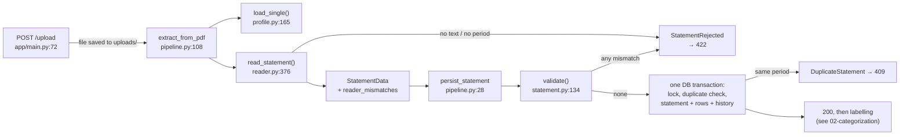

# Ingestion: PDF to reconciled statement

This is the write path from an uploaded PDF to stored transactions. A statement is either **fully reconciled against the numbers it prints**, or it is rejected with HTTP 422 and **nothing is saved**.

Related guides: [00-overview](00-overview.md) (whole system), [02-categorization](02-categorization.md) (what happens to rows after they are stored), [04-data-and-storage](04-data-and-storage.md) (tables and constraints), [05-api-security-ops](05-api-security-ops.md) (`/upload` and loopback-only), [06-testing-and-evals](06-testing-and-evals.md) (test suites), [07-interview-guide](07-interview-guide.md).

Decisions: [ADR 0002](../adr/0002-profile-based-extraction.md) (profile-based extraction with reconciliation), [ADR 0003](../adr/0003-extraction-contracts-and-data.md) (contracts, signed amounts, check output). Plan: [extraction-rebuild](../plans/extraction-rebuild.md) ("Reader rules").

---

## 1. The shape of it

| Module | Job | Imports from `app` |
|---|---|---|
| `app/statement.py` | The bank-agnostic contract (`StatementData`, `Row`, `SummaryLine`, `Mismatch`) and `validate()` | nothing |
| `app/profile.py` | Strict loader for `profiles/*.yaml` | `statement` (for `SECTIONS`) |
| `app/reader.py` | PDF to `StatementData` by word positions, driven by a profile | `profile`, `statement` |
| `app/pipeline.py` | `extract_from_pdf` and `persist_statement`: validate, then store in one transaction | `reader`, `profile`, `statement`, `models`, `categorization`, `category_store` |
| `profiles/wells_fargo.credit_card.v1.yaml` | Every Wells Fargo string, and nothing else | (data) |
| `scripts/check_profiles.py` | PASS/FAIL per real PDF, printing only check names | `profile`, `reader`, `statement` (never `models`) |
| `tests/fixtures/make_wells_fargo.py` | Synthetic statements with ground truth, built at test time | (test code) |



The key idea: **the statement prints its own totals, so correctness is checked against the document instead of trusted** (ADR 0002, Context). Two independent checks must both pass: the per-section sums and the Account Summary equation.

---

## 2. Why profile-based, not LLM extraction

### What the legacy extractor did, and how it failed

`app/extractor.py` (deleted in PR #25, commit `aeed580`) asked llama3.2 to describe the layout (`detect_structure`) and then walked text lines with a regex state machine. Its failures, from the issue tracker:

| Issue | Title | Effect |
|---|---|---|
| #6 | non-list section markers silently parse zero transactions | upload returned 200 with nothing stored |
| #7 | `end_page < start_page` silently parses zero transactions and reports success | same |
| #8 | `detect_structure` validates 3 of its 6 keys; the rest `KeyError` outside the fallback | a 500 |
| #3 item 5 | `_parse_date` returns `None` | |

ADR 0002 Context adds two silent failures found with a synthetic probe: one unmatched amount line **merged two purchases into one row with the wrong amount**, and a transaction dated just before a period that crossed a year boundary was **assigned the following year**. Nothing compared the rows to anything the statement printed, so both succeeded. The root causes: a non-deterministic, loosely validated layout description; no column awareness; no reconciliation.

### Options considered (ADR 0002)

**Row reader**

| Option | Pros | Cons | Verdict |
|---|---|---|---|
| Keep `detect_structure` + line state machine | Already written | Non-deterministic; no columns; silent zero or merged rows (#6, #7) | Rejected: already failed |
| **PyMuPDF `get_text("words")` grouped by y + profile** | Deterministic; no new heavy dependency; rebuilt every row of the real statement; Credits and Charges are distinct columns; no model call | Needs a profile per bank; no answer for scanned PDFs; y-tolerance needs tuning | **Chosen** (Decision 2) |
| PyMuPDF `find_tables()` | No grouping code | Mangled the continuation table on the real statement | Rejected |
| Docling (ML layout model) | Irregular layouts, maybe scans | Large dependency and weights; slower; opaque when wrong; still needs reconciliation | Deferred: only if reconciliation fails on real statements |

**Where bank knowledge lives**

| Option | Verdict |
|---|---|
| LLM describes the layout at upload time | Rejected: the cause of #6 to #8 |
| A Python parser class per bank | Rejected: bank strings spread through `app/`; every bank is a code review of parsing logic |
| **Declarative YAML profile per bank and account type** | **Chosen** (Decision 3): the reader is bank-agnostic; a new bank is data plus a fixture. Cost: only layouts the profile vocabulary can describe |

**Validation**

| Option | Misses |
|---|---|
| Zero-row guard only | Dropped, merged, misdated rows; wrong amounts |
| **Guard + date window + per-section totals + summary equation** (chosen, Decision 4) | A wrong date inside the window, a wrong description, two errors that cancel within one section |
| Save and flag (`statements.status`) | Needs every read query to filter on status; a flagged statement leaks into answers until all do |

Interview framing: the LLM was doing a job (layout) that has a deterministic answer and a verifiable output. Moving it out of the write path turned "probably right" into "provably reconciled or rejected". The LLM now only labels merchants and categories (ADR 0002 Consequences), where a wrong answer is visible and correctable.

---

## 3. The contract: `app/statement.py`

`statement.py` imports nothing from `app` and knows nothing about PDFs, banks or databases (`statement.py:1-9`). Any reader for any bank produces the same `StatementData`; `validate()` decides whether it can be trusted.

### Data types

| Type | Fields | Notes |
|---|---|---|
| `Row` (`:89`) | `trans_date`, `post_date`, `description`, `amount`, `section` | Dates are `Optional` in the type **on purpose**: a missing date becomes a `row_invalid` mismatch from `validate()`, not a constructor crash (a 422, not a 500) |
| `SummaryLine` (`:103`) | `value`, `sign`, `section` | `sign` is `+1`/`-1` for terms of the equation, `0` for `new_balance`; `section` names the table total this line must equal |
| `StatementData` (`:110`) | `period_start`, `period_end`, `rows`, `section_totals`, `summary`, `reader_mismatches` | Totals are **as printed**, unsigned, keyed by canonical section |
| `Mismatch` (`:63`) | `check`, `section`, `expected`, `actual` | `check` must be in `CHECKS` or `__post_init__` raises. `expected`/`actual` are strings so the 422 body never routes money through a float |
| `StatementRejected` (`:120`) | `mismatches` | The exception message holds **check names only**, because it can reach logs |
| `DuplicateStatement` (`:130`) | | Mapped to 409 |

All are frozen dataclasses (ADR 0003, 5a: dataclasses over pydantic, as written in the plan).

### Signed amounts (ADR 0003, decision 8)

`Row.amount` is signed **from the cardholder's side**: money back to you (payment, refund, credit) is positive; money out (charge, fee, interest) is negative (`statement.py:96-99`).

Why: the PR1 review found that neither check looked at the credit flag, so a Charges amount misread as a Credit passed both checks. Options were (A) no check, (B) a fixed side per section plus a new `credit_side` check, (C) signed amounts. C was chosen:
- The sign is the **only** record of direction, so sign and flag cannot disagree. `Row.is_credit` was removed from the contract. The `transactions.is_credit` column survives, derived at insert (`pipeline.py:68`).
- A single wrong sign moves its section's sum by twice the amount, so it always fails `section_total`.
- Limit: two wrong signs of equal size in a mixed section (refunds and charges) cancel. Any total-based check shares this.
- Consequence for the read path: an LLM writing SQL could drop a minus sign or rank `MAX` backwards, which is one reason the read path moved to code-owned numbers (ADR 0004, see [03-read-path](03-read-path.md)).

### Money rules

`_is_money` (`:186`): a finite `Decimal`, at most 2 decimal places, `abs(value) <= 99999999.99`. These mirror `transactions.amount Numeric(10, 2)` (`:56-60`): a value that would be rounded or refused at insert would mean the stored number differs from the validated one. `is_finite()` is checked first because comparing NaN raises.

### Canonical sections

`SECTIONS` (`:24`): `payments`, `other_credits`, `purchases`, `cash_advances`, `fees`, `interest`. Profiles must map their headings onto these; the pipeline relies on them across banks (fees and interest get fixed categories).

### Every check in `CHECKS`

`CHECKS` (`:35`) is the **only vocabulary for failures**. `check_profiles.py` prints these words and nothing else, so a new failure mode must be added here first (`:33-34`).

| Check | Raised by | Trigger |
|---|---|---|
| `no_text_layer` | `read_statement` (`reader.py:377-388`) | PyMuPDF cannot open the file, text extraction raises (e.g. encrypted), or no page has any words (scanned). Raised immediately |
| `period_not_found` | `_period` (`reader.py:113,119`); `validate` (`:147-150`) | No page matches `period.pattern` with parseable dates, or end < start. Raised immediately by the reader. `validate` repeats it for non-`date` values and stops |
| `period_mismatch` | `_period` (`reader.py:115`) | Pages disagree on the period, or a page matched the pattern but its dates did not parse |
| `header_not_found` | `read_statement` (`reader.py:393`) | No line on any page contains the profile's header labels in order |
| `summary_not_found` | `_summary` (`reader.py:150,167,207`) | No `start_label` line on any page, or on the first page that has one, no `end_label` below it or no `right_column_anchor` |
| `unknown_summary_label` | `_summary` (`reader.py:174-202`) | A summary line with an amount whose label matches no profile label, and the very next line does not complete it |
| `summary_incomplete` | `_summary` (`:205`); `_check_summary` (`statement.py:311`) | A profile summary line not found; no `new_balance`; an unreadable value or a sign outside `±1` (`0` for `new_balance`); an unknown section; two lines linked to the same section; a printed section total with no summary line linked to it |
| `row_invalid` | `_table` (`reader.py`); `_check_rows` (`statement.py:200`) | Reader: a date-shaped word outside the date columns; both or neither of Credits/Charges; an unreadable or negative amount; an empty date outside `undated_rows`, or with a post date present; an unreadable date; a total line with no amount. Validator: not a `Row`, unknown section, bad money, empty description, missing or non-`date` date |
| `no_rows` | `_check_rows` (`statement.py:201`) | Zero rows |
| `date_window` | `_table` (`reader.py:358`); `_check_rows` (`:229`) | A transaction date outside `[period_start - 7 days, period_end]` |
| `no_printed_totals` | `validate` (`:154`) | `section_totals` or `summary` is `None` (ADR 0002 Decision 5: a statement printing no totals cannot be verified, so it is rejected) |
| `section_total` | `_check_section_totals` (`:264`) | A section's signed row sum differs from `-sign × printed total`; rows in a section with no printed total; an unknown or unreadable printed total |
| `summary_equation` | `_check_summary` (`:355`) | `Σ sign × value ≠ new_balance` |
| `summary_section` | `_check_summary` (`:366`) | A summary line differs from its section's printed table total (or from zero if the table printed none) |
| `unexpected_error` | `_reader_mismatches` (`:163`); `check_profiles.check_file` | `reader_mismatches` is not a list of `Mismatch`; any crash in `check_profiles` |

`validate()` reports **every** mismatch, not the first (`:135-138`), so one upload shows everything that is wrong. It never raises on malformed input of any shape: a reader bug becomes a 422 naming a check, not a 500 (`:140-142`). Reader mismatches come first in the list.

---

## 4. Reconciliation math

Example below uses the synthetic `standard_spec()` from `tests/fixtures/make_wells_fargo.py:230`.

### Account Summary equation (`_check_summary`, `statement.py:350-356`)

The summary is written **from the balance's side** (payments reduce what you owe):

```
previous_balance (+1)   100.00
payments         (-1)   250.00
other_credits    (-1)    19.99
cash_advances    (+1)     0.00
purchases        (+1) 1,314.91
fees             (+1)     0.00
interest         (+1)    12.34
-------------------------------
computed = 100.00 - 250.00 - 19.99 + 0 + 1314.91 + 0 + 12.34 = 1,157.26  == new_balance
```

The equation is only evaluated when every line is usable; otherwise the `summary_incomplete` mismatches are returned alone, to avoid a misleading follow-on mismatch.

### Section totals (`_section_signs` `:247`, `_check_section_totals` `:264`)

Rows are written from the cardholder's side, the summary from the balance's side, so the expected signed row sum is **minus the summary sign times the printed total**:

| Section | Summary sign | Printed total | Row sum must be |
|---|---|---|---|
| payments | -1 | 250.00 | **+250.00** |
| other_credits | -1 | 19.99 | **+19.99** |
| purchases | +1 | 1,314.91 | **-1,314.91** |
| interest | +1 | 12.34 | **-12.34** |
| fees | +1 | 0.00 | 0.00 (no rows) |

The comparison is exact `Decimal` equality with no tolerance (`:303-305`). The direction for a section comes only from its summary line, so a section with no linked summary line (or two of them) is skipped here and reported by `_check_summary` instead.

### Summary vs table (`statement.py:358-367`)

Every summary line linked to a section must equal that section's printed table total, or zero if the table printed none. This is **how an unexpected cash advance fails closed**: Wells Fargo prints a Cash Advances summary line, but no cash-advance table heading has ever been seen, so the profile has no such section. A nonzero cash-advance summary value fails `summary_section:cash_advances` (tested in `test_inconsistent_statement`).

### What each check catches

| Error | Caught by |
|---|---|
| Dropped or merged row | `section_total` |
| Wrong amount | `section_total` |
| Credit read as charge | `section_total` (moves the sum by 2×) |
| Misread printed total | `summary_section` and the equation |
| Misread summary value | `summary_equation` |
| Row outside the period | `date_window` |
| Wrong date inside the window, wrong description | **nothing** (known limit) |
| Two equal errors cancelling in one section | **nothing** (shared by any total-based check) |

### Asset accounts (limit)

Deriving direction from the summary sign holds for **liability** accounts (credit cards). For checking or savings the direction reverses, so the first asset-account profile must trigger a decision on an explicit per-section direction (ADR 0003, 8; `statement.py:273-276`).
