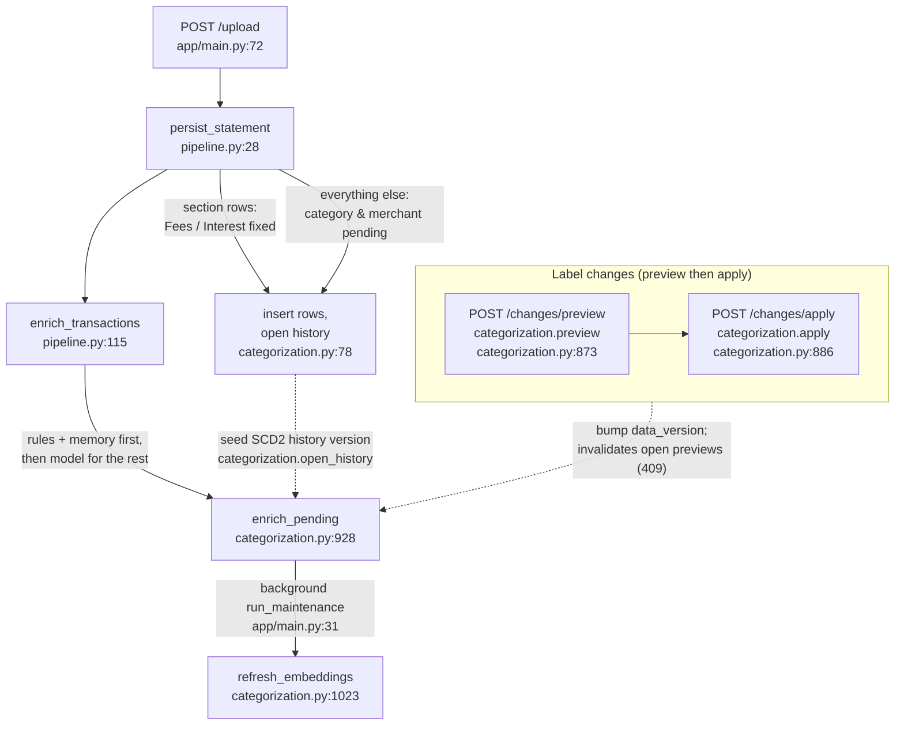

# Categorization: labels, rules, memory, preview, apply, undo

Status: drafted 2026-11-12. Verified against `app/categorization.py`, `app/category_store.py`, `app/llm.py`, `app/embedding_text.py`, `app/pipeline.py`, `app/main.py` and ADR 0005 on `main` at `2fdd28a`. Where this guide and the code disagree, the code wins.

Related guides: [00-overview](00-overview.md) (whole system), [01-ingestion](01-ingestion.md) (rows land `pending` here). [03-read-path](03-read-path.md) (how answers use stored labels), [04-data-and-storage](04-data-and-storage.md) (tables and constraints), [05-api-security-ops](05-api-security-ops.md) (the label endpoints and loopback-only).

Decision: [ADR 0005](../adr/0005-user-owned-categories.md) (user-owned categories with deterministic rules).

---

## 1. The shape of it

Every label comes from exactly one source, decided per field (category and merchant independently), strongest first:

```
section > pin > rule (by priority) > memory > model
```

| Module | Job | Imports from `app` |
|---|---|---|
| `app/categorization.py` | Precedence, rules, memory, pins, preview tokens, apply, SCD2 history, change log, undo, enrichment, embedding refresh | `category_store`, `llm`, `embedding_text`, `models` |
| `app/category_store.py` | Read-only: normaliser, description key, current categories in bulk, point-in-time name lookup | `models` only |
| `app/llm.py` | llama3.2 labelling: batches of 15, temperature 0, JSON-schema output, validated | none (uses `httpx`) |
| `app/embedding_text.py` | The embedded text and the derived `is_stale` check; no heavy imports | none |
| `app/pipeline.py` | `persist_statement`: inserts rows `pending` (or fixed by section), then `enrich_transactions` calls enrichment | `categorization`, `category_store`, `reader`, `profile`, `statement`, `models` |
| `app/main.py` | `GET /categories`, `/rules`, `/memory`, `/review`, `/changes`; `POST /changes/preview`, `/changes/apply`, `/enrichment/retry`, `/embeddings/refresh`; upload waits for labelling | `categorization`, `category_store`, `pipeline` |



Key points:
- **One pipeline for every change kind** (`_run`, `app/categorization.py:851`): snapshot every row's labels, mutate, re-resolve every row (`relabel_all`), diff. Preview runs it inside a savepoint and rolls back (`preview`, `:873`), so the preview is the real computation, not an estimate.
- **The token binds the exact payload to the data version** (`make_token`, `:83`). Any upload, enrichment write or other apply in between bumps `data_version`, and the apply gets a 409 (`apply`, `:886`).
- **History is append-only SCD2.** Undo never edits history; it is a new compensating change with `undoes = N` (`_mut_undo`, `:655`), allowed only in reverse order over overlapping changes.
- **The model is never called on the request path of a change.** Rows that lose a rule or pin fall through to memory or to `pending`, and the background pass labels them.
- **`app/` dependency rule:** the read path never imports `categorization.py` or `llm.py`, so answering a question cannot write labels or call the labelling model (00-overview, section 4.1).

---

## 2. Source precedence, per field

`resolve(tx, ctx)` (`app/categorization.py:183`) decides each field independently:

### Category

| Order | Source | What it sets | Can be overridden? |
|---|---|---|---|
| 1 | **Section** | Fees or Interest, from `category_store.SECTION_CATEGORY_KEYS` | No — pinned by the statement itself |
| 2 | **Pin** | A user pin on this row, for this field | Only the user removes it |
| 3 | **Rules** | Highest-priority matching rule that sets this field | Yes, by a later rule/edit/merge/delete |
| 4 | **Memory** | The remembered label for this row's description key | Yes, by the user or a rule |
| 5 | **Existing model label** | A `model` or `none_fit` label the row already has, if its category is not archived (`:207-208`) | Yes, by anything above |
| — | **Pending** | Nothing decides it; the model is asked on the next enrichment pass | — |

`resolve` never calls the model. Step 5 is why relabelling (after any change) keeps model-labelled rows as they are instead of sending them back to `pending`. When memory agrees with the row's existing model label, the source stays `model` rather than becoming `memory`.

A rule never overrides a pin. Section rows (`fees`, `interest`) get their fixed category and merchant (the printed description) at insert and cannot be pinned (`_pin_target`, `:607`).

### Merchant

| Order | Source | What it sets |
|---|---|---|
| 1 | **Section** | The printed description (fee/interest rows keep it) |
| 2 | **Pin** | A user-chosen merchant name on this row |
| 3 | **Rules** | Highest-priority matching rule that sets `sets_merchant` |
| 4 | **Memory** | The remembered merchant for this row's description key |
| 5 | **Existing model label** | The row's current `model` merchant |
| — | **Pending** | Falls back to the printed description until labelled |

If nothing decides a field, it is `pending`, source `pending` — never silently `Other`.

---

## 3. Rules

Rules live only in the user's database (they contain real merchant text), never in the repo, fixtures or docs (ADR 0005, decision 1).

### Rule fields (`category_rules`)
- `pattern` — what to match against the printed description (`raw_description`)
- `kind` — `contains` (normalised substring) or `regex` (case-insensitive `re.search`)
- `priority` — integer; higher wins
- `sets_category_id` / `sets_merchant` — at least one must be set
- `deleted` — soft delete; history keeps the `rule_id`

### Validation (`validate_pattern`, `:94`)
- Pattern must be non-empty and at most `MAX_PATTERN_LENGTH = 200` characters.
- Regex is compiled at creation; an invalid pattern is refused.
- A static check rejects nested repetition (`(a+)+`, `(\w*)*`, …) that causes catastrophic backtracking. Accepted risk: Python's `re` has no timeout and the check is not exhaustive (ADR 0005, 2b).

### Precedence among rules (`choose_rule`, `:122`)
All matching rules for the field are gathered; the highest `priority` wins. If several equal-priority rules match with different targets for the same field, it is a **conflict**: none applies to that field. At ingest, the row is flagged `needs_review` with a `conflict` review item; the field falls through to memory and then the model. Fail loudly — a tie never decides.

### New/edited rule conflict check (`_check_rule_conflicts`, `:507`)
Creating or editing a rule is refused if any existing row would match both the new rule and an equal-priority existing rule with a different target for the same field. The refusal lists the conflicting rule IDs, fields and transaction IDs.

---

## 4. Memory

Memory (`label_memory`) remembers a decision per **description key**, so the same store always gets the same label (fixes issue #2's name split).

### The key (`category_store.description_key`, `:37`)
Upper-case, punctuation removed, spaces collapsed, then **digits dropped**:
- `GROCER MART #101 SPRINGFIELD` → `GROCER MART SPRINGFIELD`
- `GROCER MART #202 SPRINGFIELD` → same key
- If dropping digits leaves an empty key, fall back to the normalised text with digits kept, then to the raw text, then `(BLANK)` — a key is never empty.

Memory fields are remembered independently: a merchant is remembered even when the category was `none_fit`. Each entry holds `category_id` (nullable), `category_source` (`model` or `user`), `merchant` (nullable), `merchant_source`.

### Model labels are final (`:928-1004`)
- Temperature 0 and JSON-schema-constrained output (section 5). Code validates anyway.
- **Only real categories are remembered.** `none_fit` and model failures are **never** written to memory.
- **The model never overwrites memory.** `_remember` (`:989`) fills only an empty category (or one that points at an archived category) and an empty merchant. A user's `set_memory` always wins over the model.
- A `none_fit` row gets `Other`, source `none_fit`, `needs_review`, and a `none_fit` review item holding the suggestion. The next row with that key is asked again, and flagged again if still `none_fit`.
- A wrong remembered label repeats until corrected — memory makes labels consistent, not correct (accepted risk, ADR 0005, 3c).

---

## 5. Model labelling (`app/llm.py`)

The model's only write-path job: label descriptions that no pin, rule or memory covers (ADR 0005, decision 3).

| Setting | Value |
|---|---|
| Model | `llama3.2` via Ollama at `http://localhost:11434/api/generate` |
| Temperature | 0 |
| Output | JSON-schema-constrained (`format`: schema) |
| Batch size | 15 descriptions per call |
| Timeout | 120 s |

Schema (`_schema`, `:30`): each label has `id`, `category` (one of the offered names or `none_fit`), `merchant` (1–80 chars), and `suggestion` (only with `none_fit`, ≤ 3 words). Validation (`_validate`, `:66`) rejects anything outside it — a bad answer returns `None` for that description and leaves the row `pending`, never `Other`.

Rows with the same memory key are sent to the model once per enrichment pass: `enrich_pending` deduplicates by key (the `needed` dict) before `label_descriptions` (`app/llm.py:106`) splits the keys into batches of 15. The model call happens **outside** the `data_version` lock; writes happen under it after re-checking each row is still pending (`enrich_pending`, `:928`).

---

## 6. Pre-enrichment state (at insert)

`pipeline.persist_statement` (`app/pipeline.py:28`):
- Fee and interest rows (`section in {fees, interest}`) get `category_id` = the system category (Fees/Interest), `category_source = "section"`, `merchant_source = "section"`, merchant = printed description. Fixed at insert, cannot be pinned.
- Every other row is inserted `pending`: `category_id = NULL`, `category_source = "pending"`, `merchant = raw_description`, `merchant_source = "pending"`.
- An SCD2 history version is opened for every row (`categorization.open_history`, `:234`), with `change_id = NULL` for ingest.

Rows stay `pending` until enrichment runs (synchronously after upload, then in the background).

---

## 7. Enrichment pass (`enrich_pending`, `:928`)

```
pending rows
  └─ rules + memory resolve what they can (no model call)
      └─ remaining keys → llama3.2 (outside the lock)
          └─ under the lock: re-check still pending, write labels,
             history, memory; bump data_version only if something changed
```

Flow for each pending row:
1. `resolve` with rules + memory. If a field is still `pending`, the raw description (normalised to a key) is queued for the model.
2. Model labels the queued keys (batches of 15, temperature 0).
3. Re-acquire the `data_version` lock, re-resolve each row (an apply may have labelled it meanwhile).
4. `none_fit` → category `Other`, source `none_fit`, review item with the suggestion. Model failure → stays `pending`, review item opened only once the model has actually been asked.
5. Valid model label → written, source `model`, remembered in memory (category and/or merchant, independently).
6. `set_labels` closes the open SCD2 history version and opens a new one; `sync_review` opens/closes review items.
7. If anything changed, `bump_version` — invalidating open previews (they return 409 on next apply).

Result: `label_counts` (`needs_review`, `pending`) plus `enriched` (rows the pass decided). Called:
- synchronously after each upload (`pipeline.enrich_transactions`, `:115`, so `/upload` waits for labelling — ADR 0005 option A),
- in the background via `run_maintenance` (`app/main.py:31`) after upload and after each apply,
- at app startup (`lifespan`, `:47`) because FastAPI background tasks die on restart,
- on demand via `POST /enrichment/retry` (`POST /embeddings/refresh` only re-embeds; it does not label).

---

## 8. Review items (`review_items`, opened by `sync_review`, `:272`)

| Kind | When it opens | What it holds |
|---|---|---|
| `none_fit` | Model answered `none_fit` for the row | The model's suggestion (≤ 3 words) |
| `pending` | Model was asked and failed to decide a field | — |
| `conflict` | Equal-priority rules disagree for a row's field | The conflicting rule IDs and targets |

Items are grouped by description key in `GET /review` (`app/main.py:239`), so one `set_memory` fix covers every row of that key. An item is resolved (never deleted) when its kind no longer applies; its `detail` is refreshed if the underlying conflict changes. `tx.needs_review` mirrors whether any item is open.

---

## 9. Changes: preview, then apply

Every change that can relabel more than one row is two calls: `POST /changes/preview` then `POST /changes/apply` with the same `kind` and `params`, plus a `token` on apply.

### Preview (`categorization.preview`, `:873`)
Runs the full mutation pipeline inside a savepoint and rolls it back. Returns:
- `token` — `version:sha256(version|canonical_payload)[:32]`, binding the exact payload to `data_version` at preview time
- `data_version` — the version previewed against
- `effect` — `rows_changed`, `to_pending`, `to_memory`, and up to `PREVIEW_SAMPLES = 5` before/after samples

Single-row changes (`pin`, `unpin`) need no token (`NO_PREVIEW_KINDS`, `:40`).

### Apply (`categorization.apply`, `:886`)
Takes `SELECT … FOR UPDATE` on `data_version` (`lock_version`, `:74`), checks the token matches `make_token(payload, version)` — otherwise 409 `StalePreview` — writes the `ChangeLog` entry, runs `_run`, bumps `data_version`, commits, all in one transaction. A changed version (a later change **or an upload**) or a different payload refuses with 409.

After apply, `run_maintenance` is enqueued as a background task so newly-pending rows get labelled and relabelled rows get re-embedded.

### The single pipeline (`_run`, `:851`)
1. Snapshot every row's labels first (so the effect counts rows the mutation itself wrote — pins re-pointed by a merge, dropped by a delete).
2. Run the kind's mutation.
3. `relabel_all`: re-resolve every transaction, write SCD2 history for changed rows, sync review items.
4. Diff snapshot vs. current → the `changed` list driving the effect.

---

## 10. Change kinds (`CHANGE_KINDS`, `:831`)

| Kind | Params | What it does | Token needed? |
|---|---|---|---|
| `create_category` | `{name}` | New user category + current version | Yes |
| `rename_category` | `{category_id, name}` | Close current version, open new one with the new name; no row labels change | Yes |
| `merge_category` | `{source_id, target_id}` | Re-point source's rules, memory, pins to target; archive source | Yes |
| `delete_category` | `{category_id}` or `{category_id, into}` | With `into`: a merge. Without: withdraw the category — rules that only set it are soft-deleted (rules that also set a merchant keep the merchant part), memory forgets it, pins dropped, its rows fall to `pending`, category archived. Nothing moves into `Other` silently. | Yes |
| `create_rule` | `{pattern, kind, priority, category_id?, merchant?}` | New rule; refused if equal-priority conflict with existing rows | Yes |
| `edit_rule` | `{rule_id, ...}` | Edit an active rule; same conflict check | Yes |
| `delete_rule` | `{rule_id}` | Soft-delete (`deleted = true`) | Yes |
| `set_memory` | `{description_key, category_id?, merchant?}` | Remember (or clear) a label per key; key normalised | Yes |
| `pin` | `{transaction_id, field, value}` | Pin category or merchant on one row (not on section rows) | No |
| `unpin` | `{transaction_id, field}` | Drop the pin; row re-resolves from rules/memory or goes pending | No |
| `undo` | `{change_id}` | Compensating change restoring change #N's before-snapshot | Yes |

System categories `Fees`, `Interest`, `Other` cannot be renamed, merged, deleted, or used as rule/pin targets, and are never offered to the model. `none_fit` and `pending` are reserved names.

---

## 11. SCD2 label history

`transactions` carries the current label columns (`category_id`, `category_source`, `category_rule_id`, `merchant`, `merchant_source`, `merchant_rule_id`). `transaction_label_history` mirrors them exactly, one row per version (`transaction_id`, all label columns, `valid_from`, `valid_to`, `change_id`).

- Applying a change closes affected open versions (`valid_to = now`) and opens new ones (`valid_from = now`).
- "Current equals open history" is a strict equality. `set_labels` (`:240`) maintains it by closing the open version and opening a new one in the same instant; the integration suite checks it with `assert_history_matches` (`tests/integration/test_categorization_db.py:82`).
- History is append-only: closed versions are never reopened or edited.
- Point in time: a row's labels on a date are the version valid on that date; the category name is the category version valid on that date (ADR 0005, 5a).

Undo restores from a before-snapshot as a **new** change (`undoes = N`), never by rewriting history.

---

## 12. Undo (`_mut_undo`, `:655`)

Undo is allowed only if **no later, not-itself-undone change touched any row, rule, memory entry or category that #N touched** (`_overlaps`, `:682`). Otherwise it is refused, listing the blocking change IDs (newest first). Undo ignores changes already compensated by an undo, so reverse-order undo works to any depth.

Two more refusals: an undo cannot itself be undone (make the change again instead), and a change that is already undone cannot be undone twice (`_mut_undo`, `:660-664`).

Undo never restores a pointer to a category that is archived now (`_usable_target`, `:752`). Restorers exist for every kind (`_UNDO`, `:805`):
- `create_category` → archive the category, forget model-learned memory for it
- `rename_category` → reopen the before-name version
- `merge_category` / `delete_category(unassign)` → reopen source's version, restore rules/memory/pins
- `create_rule` → soft-delete the rule
- `edit_rule` / `delete_rule` → restore the before state (with re-conflict check if un-deleted)
- `set_memory` → restore the before memory entry (or delete it if it didn't exist)
- `pin` / `unpin` → restore the before labels

After an undo, rows are re-resolved by normal precedence, so a formerly `model` row can come back as `memory` with the same category. A row with nothing to re-resolve from falls to `pending` and is asked again (accepted limit, ADR 0005, G).

---

## 13. Embeddings (`refresh_embeddings`, `:1023`)

Embedded text is `merchant + raw_description + category` (`build_embedded_text`, `app/embedding_text.py:7`). A row is **stale** when its stored `embedded_text` differs from what `build_embedded_text` would produce now (`is_stale`, `:14`) — derived, not flagged, so a lost background task self-heals on the next refresh.

`refresh_embeddings(session, embed, batch_size=32)` scans every row, re-embeds stale ones in batches of 32, committing per batch. Called:
- in `run_maintenance` after enrichment (`app/main.py:39`),
- on demand via `POST /embeddings/refresh` (`app/main.py:295`).

A rename or merge makes that category's rows stale; the batch refresh picks them up. A pending row is embedded with an empty category name and refreshed once labelled. Search answers state how many embedded rows in their period are stale (`calculations.notes`, `app/calculations.py:176`).

---

## 14. Database tables (`app/models.py`)

All hold real user data (merchant text, rules, memory) — in the user's database only, never in the repo.

| Table | Content |
|---|---|
| `category_ids` | `category_id` (PK), `is_system`, `created_at`. Durable identity; FK target for every category reference. System categories keyed by `system_key` (`fees`, `interest`, `other`), not fixed numeric IDs. |
| `category_versions` | `category_id` (FK), `name`, `archived`, `valid_from`, `valid_to` (empty = current), `change_id`. SCD2. |
| `category_rules` | `rule_id`, `pattern`, `kind` (`contains`/`regex`), `priority`, `sets_category_id` (nullable FK), `sets_merchant` (nullable text), `deleted` (soft), timestamps. |
| `label_memory` | `description_key` (unique), `category_id` (nullable FK), `category_source` (`model`/`user`), `merchant` (nullable), `merchant_source`, timestamps. |
| `transaction_label_history` | SCD2 per transaction: all current label columns plus `valid_from`, `valid_to`, `change_id` (nullable for ingest). |
| `change_log` | `change_id`, `kind`, `payload`, `before`/`after` snapshots, `touched`, `undoes` (nullable), timestamp. |
| `review_items` | `review_id`, `transaction_id`, `kind` (`none_fit`/`pending`/`conflict`), `detail` (JSON), `created_at`, `resolved_at`, `resolved_by_change_id`. |
| `data_version` | Single row; bumped by every logged change, every upload, every enrichment write that changed something. |

### Database-enforced invariants
- One open version per category: partial unique index on `category_versions(category_id) WHERE valid_to IS NULL`.
- One open history version per transaction: same pattern on `transaction_label_history`.
- Unique `label_memory.description_key`.
- Unique current name among non-archived categories, case-insensitive (partial unique index on `lower(name) WHERE valid_to IS NULL AND NOT archived`).
- `category_id IS NULL` exactly when `category_source = 'pending'` (check constraint).
- `category_rule_id` is set exactly when `category_source = 'rule'`; the same for `merchant_rule_id` (check constraints).
- A rule sets a category, a merchant or both; its `kind` is `contains` or `regex`; its pattern is 1 to 200 characters (check constraints).
- `label_memory` sources are `model` or `user`, and each source is null exactly when its value is null (check constraints).
- Review item `kind` is `none_fit`, `conflict` or `pending` (check constraint).

Enforced in code, not the database: `none_fit`, `pending` and placeholder words (`null`, `none`, `n/a`, ...) cannot be category names (`_check_name`, `app/categorization.py:343`).

### Columns added to `transactions`
`category_id` (nullable FK), `category_source`, `category_rule_id`, `merchant_source`, `merchant_rule_id`. `merchant` stays `NOT NULL` — holds the printed description until labelled (`merchant_source = 'pending'`). A field is pinned exactly when its source is `pin`; there is no separate pinned flag that could disagree.

---

## 15. API endpoints (categories, rules, memory, review, changes)

All unauthenticated, loopback-only (`app/main.py:59`).

| Method | Path | Purpose |
|---|---|---|
| GET | `/categories` | Current categories (id, name, archived, is_system, system_key) |
| GET | `/rules` | Rules (optionally `include_deleted`), ordered by priority desc |
| GET | `/memory` | All memory entries, keyed by description key |
| GET | `/review` | Open review items grouped by `(description_key, kind)` |
| GET | `/changes` | Change log, newest first (default 50, max 500) |
| POST | `/changes/preview` | `{kind, params}` → token, data_version, effect |
| POST | `/changes/apply` | `{kind, params, token}` → change_id, effect (409 if stale) |
| POST | `/enrichment/retry` | Label pending rows, then counts |
| POST | `/embeddings/refresh` | Re-embed stale rows → `refreshed` count |

`/upload` also waits for labelling and returns `enriched`, `needs_review`, `pending` (`app/main.py:112`).

---

## 16. Known limits and loose ends

- **Preview takes no lock.** A preview racing an apply can rarely hit a row-lock deadlock (500); the token still guarantees nothing stale is applied. Single-user risk; retry the preview (ADR 0005, G).
- **Scale.** Preview and apply re-resolve every row and check review items per row under the lock; embedding refresh scans every row. Fine at thousands of rows; apply latency and lock-hold time are the first to go, around tens of thousands (unmeasured).
- **Undo restores categories, not always sources.** After an undo, rows are re-resolved by normal precedence, so a formerly `model` row can come back as `memory` with the same category. A row with nothing to re-resolve from falls to `pending` and is asked again.
- **A merge only re-points what points at the source.** A `model` row whose key has no memory entry (possible after clearing memory by hand) falls to `pending` rather than to the target — visible in the preview as `to_pending`.
- **Model-chosen labels are final.** A wrong remembered label repeats until corrected; only the user can fix it via `set_memory`, a rule, or a pin.
- **Catastrophic backtracking.** The nested-quantifier static check is not exhaustive; a pathological regex can stall a request (and, inside an apply, hold the `data_version` lock). The only pattern author is the local user (ADR 0005, 2b).
- **One model call per ~15 distinct descriptions** at enrichment; bulk history import would want async (ADR 0005, upload option B declined for now).
