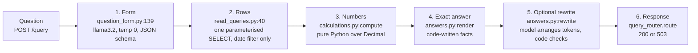

# Read path: ask a question, get an exact answer

Status: drafted 2026-11-12. Verified against `app/query_router.py`, `app/question_form.py`, `app/calculations.py`, `app/answers.py`, `app/read_queries.py`, `app/read_config.py` and ADR 0004 on `main` at `2fdd28a`. Where this guide and the code disagree, the code wins.

Related guides: [00-overview](00-overview.md) (whole system), [01-ingestion](01-ingestion.md) (what gets stored), [02-categorization](02-categorization.md) (stored labels), [04-data-and-storage](04-data-and-storage.md) (tables and constraints), [05-api-security-ops](05-api-security-ops.md) (`/query` and loopback-only), [06-testing-and-evals](06-testing-and-evals.md) (form eval).

Decision: [ADR 0004](../adr/0004-code-owned-read-path.md) (code owns every number on the read path).

---

## What this doc covers

- The six-step flow: question → form → rows → numbers → answer → optional rewrite
- The 12 supported question types, and what's refused
- The form fields, directions, periods and coverage
- Merchant matching and merchant/category validation
- Placeholder rewrite + the "Understood as" line
- "Looks like" search
- The `/query` response and HTTP outcomes

---

## At a glance

| Piece | File | Responsibility |
|---|---|---|
| Orchestration | `app/query_router.py:106` | `route()`: form → rows → numbers → answer → rewrite |
| Form | `app/question_form.py` | Model fills a schema-constrained form; code resolves dates/merchants |
| Rows (SQL) | `app/read_queries.py` | Thin parameterised SQL: rows by date, periods, merchants, vector search |
| Numbers | `app/calculations.py` | Every number in pure Python `Decimal` |
| Answer | `app/answers.py` | Code-written facts, placeholder rewrite, "Understood as" line |
| Settings | `app/read_config.py` | Thresholds, the form data types, closed glue-word list |
| Decision | `docs/adr/0004` | Option C: LLM fills a form, code computes and states every number |

- Model calls per answer: **1** for the form, plus **1** optional rewrite (sentence answers only). Tables are never rewritten.
- Unreachable/timed-out model at the form step → **503**.
- Refused questions (unsupported, not understood, unknown category, no merchant match, insufficient coverage) → **200** with `type: refused` and a reason.
- Dependency rule: **the read path never imports `categorization.py` or `llm.py`** — answering cannot write labels or call the labelling model.

---

## The flow



Walkthrough:

1. **Form.** The model receives the question plus few-shot examples (`TEACH_EXAMPLES`, `app/query_router.py:23`) and returns a schema-constrained JSON form: `type`, `direction`, `category`, `merchant`, `period`, etc. It only copies words into fields — it never does date arithmetic or name matching.
2. **Validation & resolution.** `question_form.resolve` (`:361`) checks the form and resolves what the model could get wrong silently: relative dates against an injected `today`, yearless dates to the most recent past occurrence, merchants by containment (≥3 chars) or ≥90% similarity, per-type defaults, and only the fields a type applies. Anything it can't resolve → `Refusal`.
3. **Rows.** `read_queries.fetch_rows` runs one parameterised SELECT filtered only by date (plus statement periods, merchant names, vector search for `search`). Direction, category and merchant filters are applied **in Python** over the fetched rows, so refunds beside spending, `needs_review` counts and no-embedding counts all come from the same fetch.
4. **Numbers.** `calculations.compute` produces every number in pure Python over `Decimal`. No model, no SQL math.
5. **Exact answer.** `answers.render` writes every fact as a complete phrase behind an opaque token (`[F1]` = "you spent $300.00 on Groceries"), then joins them into `answer_exact`.
6. **Rewrite.** For sentence-type answers only, llama3.2 receives the opaque tokens (never their contents) and arranges them into a natural sentence. Code accepts it only if every token appears exactly once in order, with no digits and no banned glue word outside tokens. Any failure → `answer` falls back to `answer_exact`. Rankings, lists and trends are never rewritten.

---

## The 12 question types

| Type | Example | Code computes |
|---|---|---|
| `total_spent` | "How much did I spend on groceries in December?" | Sum of spent rows, shown positive. Refunds beside it, never netted. |
| `total_received` | "How much did I pay off in December?" | Sum of payments/refunds/received rows |
| `count` | "How many purchases in December?" | Row count in the chosen direction |
| `ranking` | "Where did I spend the most?" / "Spending by category" | Merchants or categories ranked, most or least |
| `largest` | "Biggest purchases?" | Largest single spent rows |
| `list` | "Show my DoorDash orders in March" | Matching rows, capped at 50 ("showing 50 of N") |
| `compare` | "Did I spend more May 5 to July 5 than before?" | Two totals and the difference over any two ranges |
| `monthly_trend` | "How has my spending changed month to month?" | Spend per calendar month |
| `category_change` | "Which category saw improvement?" | Per category, between two ranges, sorted by largest decrease |
| `savings_opportunities` | "Where can I cut down spending?" | Recurring charges, categories above their average, fees and interest |
| `anomalies` | "Any anomaly categories?" | Latest full month > 1.5× median of previous full months and ≥ $50 above |
| `search` | "Find charges that look like parking" | Similarity search over embeddings, capped at 50 |

Anything not in this list → `unsupported`, refused and logged. The full list comes back with every refusal so the user can see what's supported.

---

## Form fields

| Field | Values | What it means |
|---|---|---|
| `type` | one of the 12, or `unsupported` | The question type |
| `direction` | `spent` (default), `payments`, `refunds`, `received` | Direction on signed rows |
| `group_by` | `merchant` or `category` | For `ranking` only |
| `order` | `most` or `least` | For `ranking` only |
| `limit` | 1–50 (default 5) | For `ranking` and `largest` |
| `category` | optional free text | Validated case-insensitively against the known category list |
| `merchant` | optional free text | Matched against stored merchant names |
| `search_text` | free text | For `search` only |
| `period`, `period_2` | `YYYY-MM`, `--MM`, `YYYY`, `--MM-DD..--MM-DD`, relative tokens, `all` | Resolved by code |

**Directions** (`app/calculations.direction_params`, `:114`):
- `spent` — `amount < 0` (purchases, cash advances, fees, interest)
- `payments` — `amount > 0` in section `payments`
- `refunds` — `amount > 0` outside section `payments`
- `received` — all `amount > 0`

Spending totals are gross: `refunds` under the same filters are stated beside the total, never netted. `0.00` rows are never counted; they appear only in `list`.

**Periods** are resolved relative to an injected `today`, never inferred from data:
- `this_month`, `last_month`, `last_3_months`, `this_year`, `last_year`, `ytd`, `all`
- A month or day without a year (`--12`, `--05-05`) resolves to the most recent occurrence that has started on or before today; on 11 Nov 2026, "December" is Dec 2025.

**Coverage** (`full`, `partial`, `none`) is computed per day from statement periods and stated on every answer. Totals and single-range types answer with "partly covered"; `compare` and `category_change` refuse unless both ranges are fully covered, and offer the largest comparable range.

---

## Merchant matching (`question_form.py`)

Both sides normalised (lowercase, punctuation removed, spaces collapsed). A stored merchant matches if:
- it **contains** the typed text, and the text is at least 3 characters (`costco` → "Costco Wholesale"), or
- it is at least **90% similar** (`difflib.SequenceMatcher`) to the whole name or any word in it (`costcoo` → "Costco Wholesale", `dordash` → "DoorDash").

Every answer lists the merchants it counted. No match → "no merchant matching 'X'", with the closest names offered. It never silently picks one.

Unknown category: tried as a merchant only if it equals whole words of a merchant name and is not within 0.75 similarity of a category name; otherwise the category refusal stands.

---

## Who writes the sentence (placeholder rewrite)

Code writes every fact first:

```
[F1] = "you spent $300.00 on Groceries"
[F2] = "Dining came to $200.00, down $40.00 from November"
```

`answer_exact` joins the phrases. llama3.2 then receives only the **opaque tokens** plus the question type and writes a natural sentence using each token exactly once. Code accepts it only if:
- every token appears exactly once, in order
- no digits outside tokens
- no word from the **closed glue-word list** (`app/read_config.GLUE_BANNED_WORDS`) outside tokens — comparison, negation, quantities, approximators, exclusions, direction verbs, rates, conditionals, judgement words
- a length cap of 300 chars

On any failure (or model timeout) → `answer` is `answer_exact`. Tables are never rewritten; only sentence types (`total_spent`, `total_received`, `count`, `compare`, `search`) get the rewrite.

Formatting is fixed by code: money `$1,234.50`, percentages one decimal, dates `5 Dec 2025`.

---

## The "Understood as" line

Shown on **every** answer, built by code from the validated form, never rewritten (`app/answers.understood_as`):

> Understood as: spent · merchants Costco, Costco Wholesale (matched "costco") · last month = 1–31 Oct 2026 · partly covered (1 Oct to 31 Oct 2026)

It shows direction, category, matched merchants with the typed text, resolved dates, and coverage. This is the read path's runtime check — as reconciliation is the write path's — so a misread is always visible, never silent.

---

## "Looks like" search

`search` fetches spent rows (or the chosen direction) within a 0.75 cosine-distance cutoff, with optional date/direction/category/merchant filters applied **in SQL before the cap**, capped at 50. The answer lists matches with a code-computed count and total over exactly those rows, and states plainly that this is similarity search — it may miss some or include near-misses.

Rows without an embedding cannot match; the answer says how many such rows fall in the period.

---

## The `/query` response

| Field | Content |
|---|---|
| `type` | one of the 12 types, or `refused` |
| `answer` | accepted rewrite, else `answer_exact` |
| `answer_exact` | the code's template answer |
| `rewrite` | `accepted`, `rejected` or `skipped` |
| `understood_as` | the interpretation line |
| `interpretation` | the validated form: direction, category, merchants, period, coverage |
| `result` | computed numbers; money as strings |
| `rows` | rows used, capped at 50, with `rows_total` |
| `notes` | data-quality notes: `needs_review` / off-list rows, rows without embeddings (search) |
| `query` | template name and parameters |

| Outcome | HTTP |
|---|---|
| Answered | 200 |
| Refused (unsupported, not understood, unknown category, no merchant match, coverage insufficient) | 200, `type: refused` |
| Model unreachable or timed out at the form step | 503 |
| A bug | 500 |

Timeouts: 30 s for the form call, 15 s for the rewrite. A rewrite timeout falls back to `answer_exact`.

---

## Known limits

- **llama3.2 reads questions poorly** — 37.8% whole-form accuracy on 82 synthetic questions; weakest types: `search` 0/7, `largest` 0/4, `savings_opportunities` 0/4, `ranking` 1/8; weakest field: `period`. The always-on "Understood as" line is the mitigation: a miss is a refusal or a visibly misread question, never an invented number.
- **Prompt-side fixes have hit their limit** on this model (ADR 0004, section 3). A larger local 7–8B model is the recommended follow-up (findings recommendation 2), needs a new-model ADR.
- **Scale:** fetching rows into Python suits one person's statements (thousands of rows); degrades somewhere around 10⁵–10⁶ rows, at which point aggregation moves back into SQL.
- **History and comparison types** fetch every row, including history outside the asked period — stays within the scale limit above.
- **Only the user can check intent.** The "Understood as" line shows the interpretation; there's no automated intent verification.
- **Search cutoff 0.75 at cap 50 is unverified** — the search eval should be re-run at the new cap (`app/read_config.py:28`).
